PR LINK: https://github.com/Pintakasi/CCC181/pull/2

## 1 Title details:
   App name: Fix Point
   Setting: Cellphone repair shop

## 2 Personas:

   See the [full persona profiles](personas/personas.md).

### Winston, the staff member

> "Every customer deserves to feel valued and leave my shop satisfied, even on the busiest days."

**Top tasks:** Check and notify customers in the queue; check how many people are ahead; join or withdraw from the queue.

### Rey, the person waiting

> "I don’t want to travel all the way to Cagayan de Oro only to find out that the shop is too busy."

**Top tasks:** Check the current queue; join the queue and get a ticket ID and wait for his turn.

## 3 Wireframes

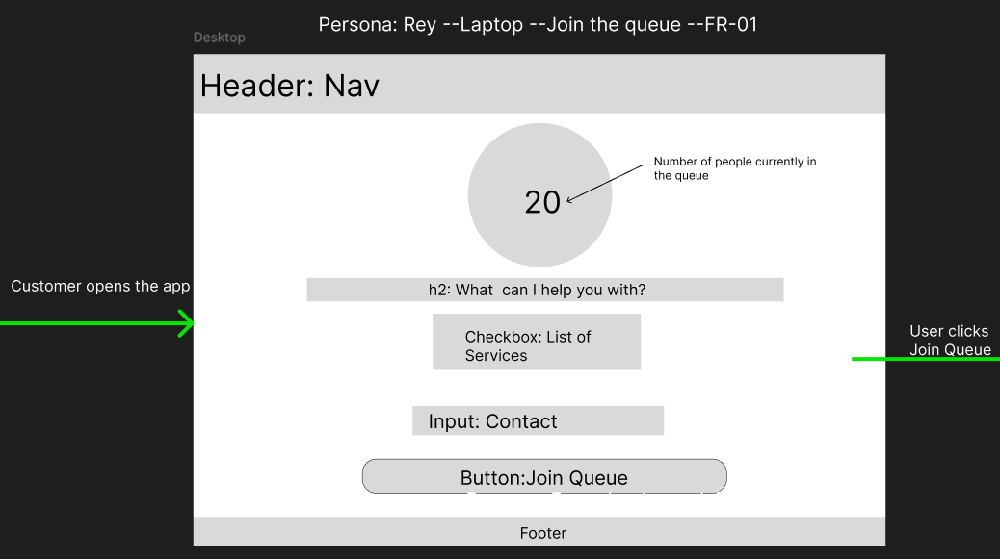
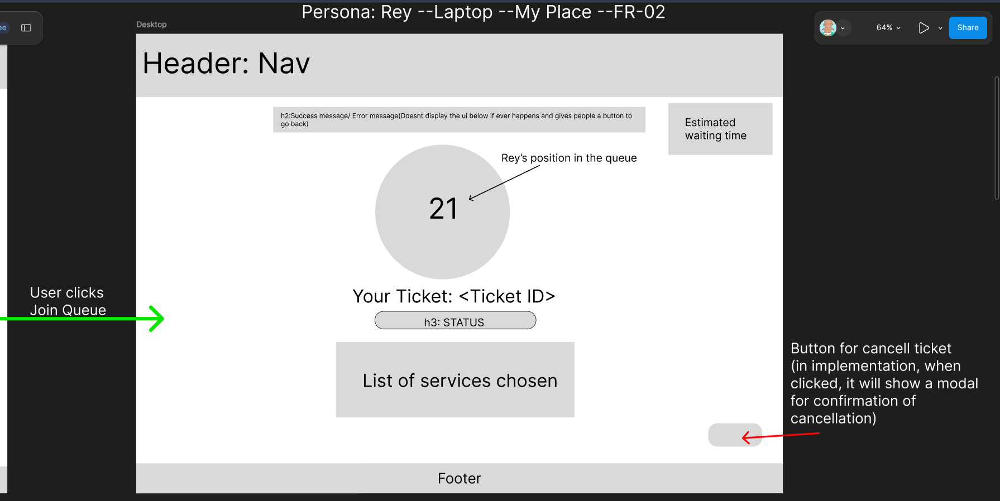
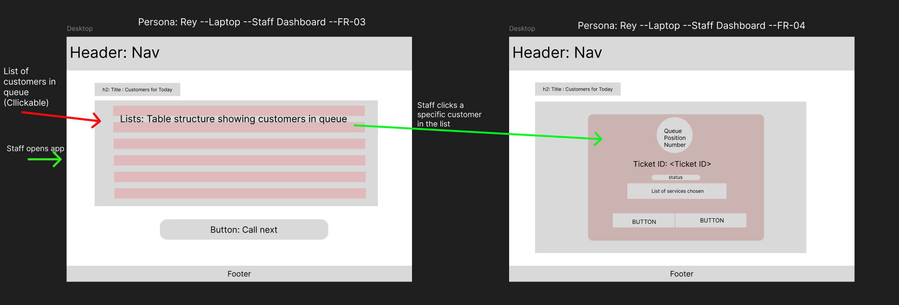

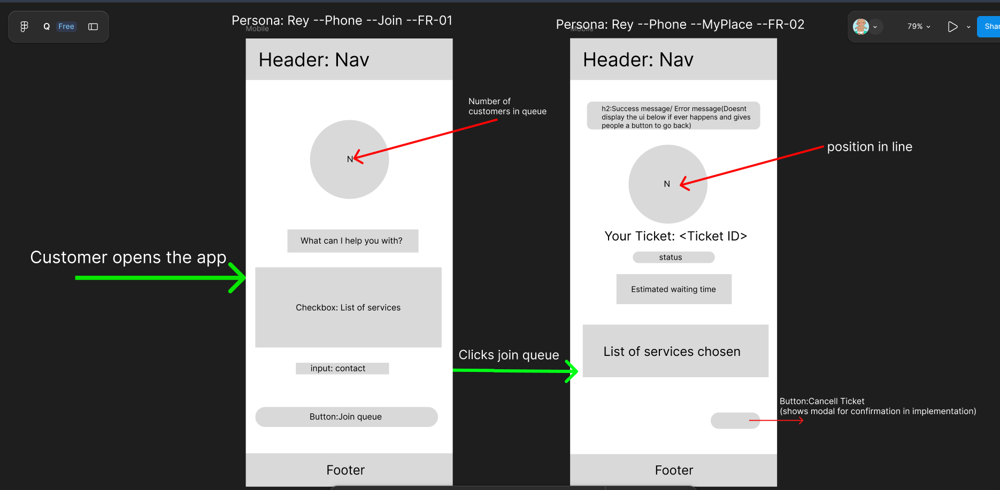
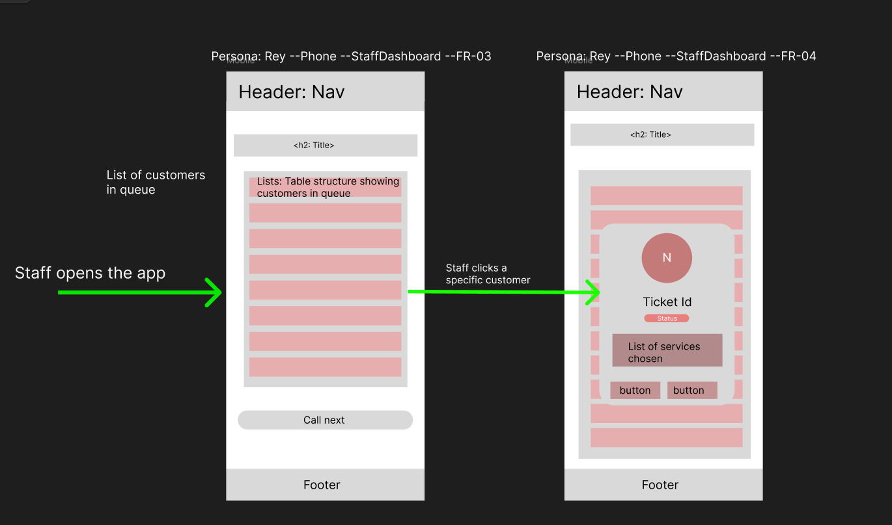

## 4 Design decisions
   Because my persona Winston is busy repairing, he must can quickly call the customer next in line without having to manually look the table who is next to call, that is why I made a big button that calls the next in line, since also he is old, I made buttons and fonts larger than usual. In the customer screens, Since its very important for my persona named Rey to know which position becuase it determines when he will start to travel to CDO, the number of how many people are ahead of him is the biggest and most noticeable thing he sees in My Place screen. I design the UI so that there is no need also to click or navigate to know which positon he is since its already directly presented in MyPlace Screen.

## 5 Self review
([feedback notes](feedback.md)):

- **Join the queue:** The screen had no way to identify or contact the customer. I added a contact-information input.
- **My Place:** The screen lacked an estimated wait time, showed the cancel action too prominently, and did not show the selected service. I added an estimated wait time and selected-service information, and made the cancel button smaller and less prominent.
- **Staff dashboard:** The screen lacked a clear primary action to call the next customer, and the customer details modal omitted the selected service. I added a “Call Next” action to notify the next customer in queue and included the selected service in the modal.

I also added a footer to the laptop Join Queue and My Place wireframes for consistency with the other screens.

## 6 Accessibility

Lighthouse accessibility scores and screenshots:

| Screen | Score | Screenshot |
| --- | ---: | --- |
| Join Queue | 100 | 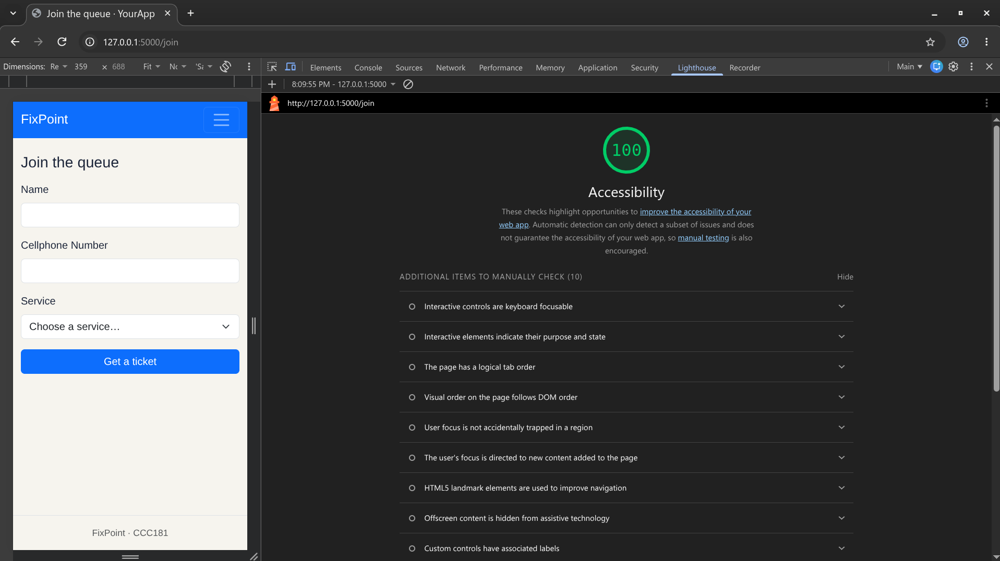 |
| My Place | 100 | 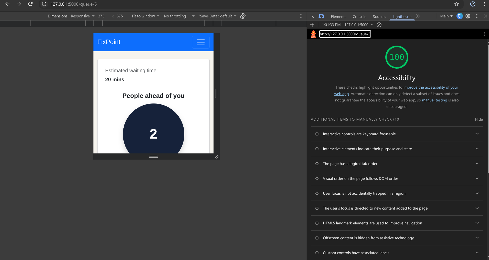 |
| Staff Dashboard | 95 | 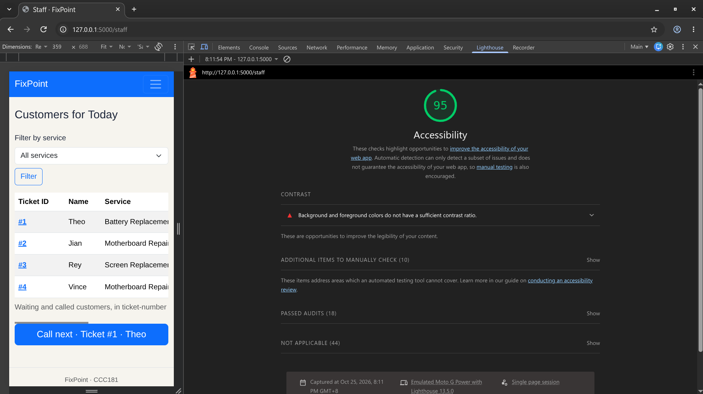 |

Since the light house scores are greater than 90, I did not fix anything in the UI

## 7 Usability test

- **Join the queue:** Completed successfully in about 6 seconds without hesitation. The larger text helped the participant navigate.
- **Check people ahead and ticket position:** Completed successfully in about 7 seconds. The participant paused briefly and initially mistook the number of people ahead for their own position.
- **Call the next person and mark them served:** Completed with help in about 10 seconds. The participant needed help finding the staff dashboard; But I attribute this to the not-yet-implemented login and role-based routing.

**Improvement made:** I made the “People ahead of you” indicator more noticeable with larger, bolder, darker text and a subtle shadow on the count circle. The count still represents the number of people ahead, not the tiMyScreenket holder’s position.

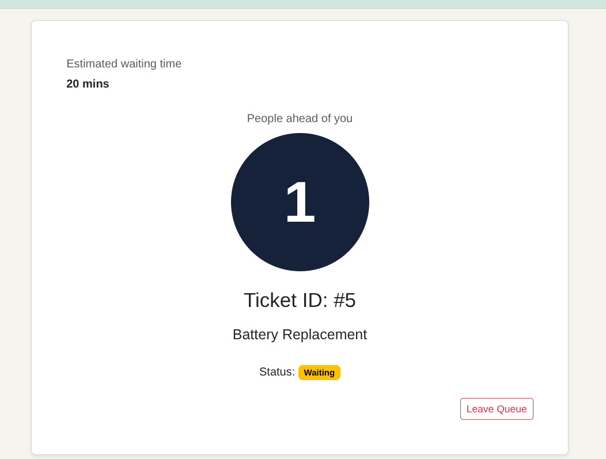
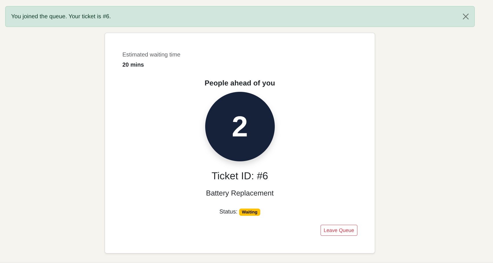

## 8 Reflection
   The hardest part this week is the unfamiliarity of the tech stack since I usually use Java and Springboot as the backend tech stack for my web app projects. I would probably remove the Staff Dashboard in the navbar, when there is already a database, I can implement login feature that it automatically displays user or staff dashboard depending on the user role. I will also add functionalities in the My Place screen, right now its just static. 

## 9 Declaration
   I used Copilot in vscode to assist me in understanding the initial code of my-app since this is my first time using python+flask+jinja as a tech stack in making web application. Overall, I used it as a guide.

## USABILITY TEST SCREENSHOT

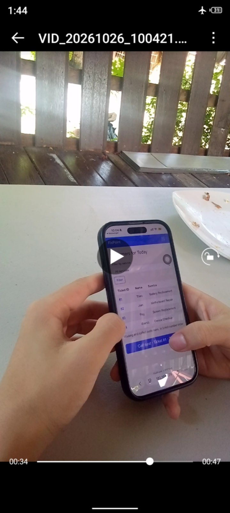
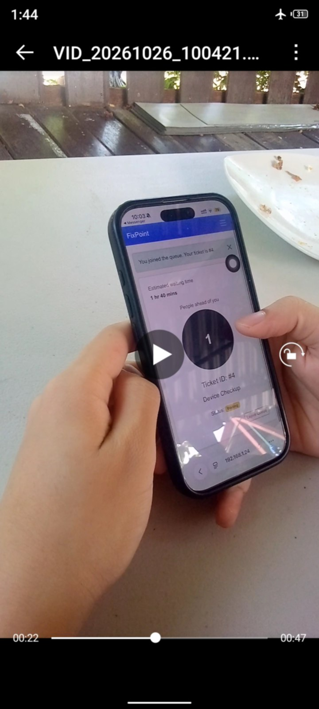
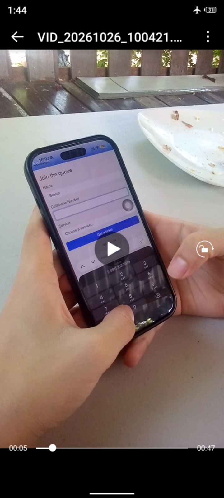