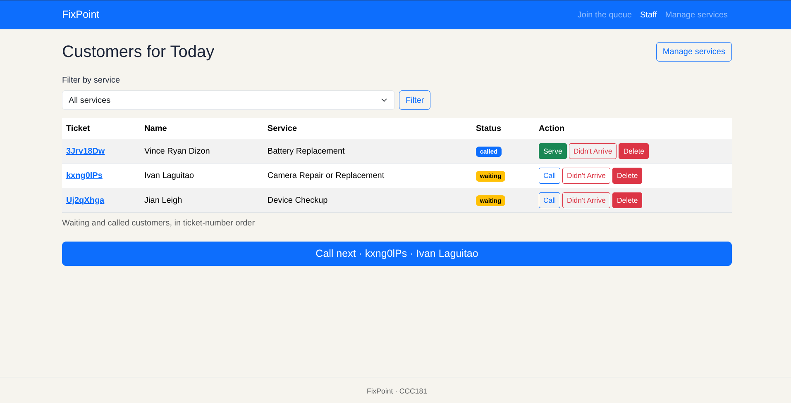
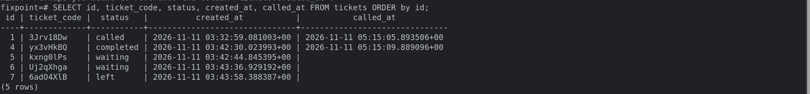
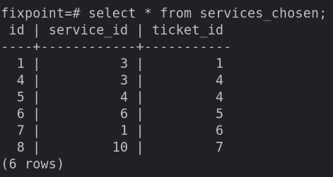
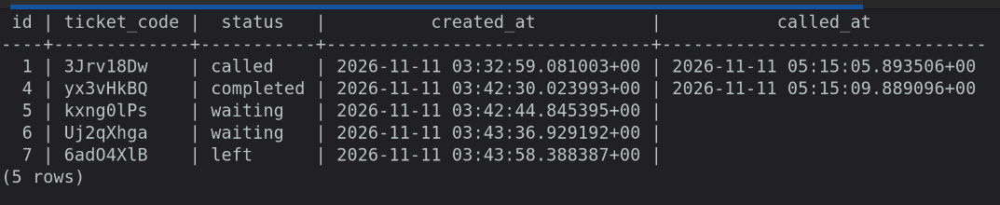
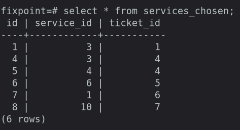
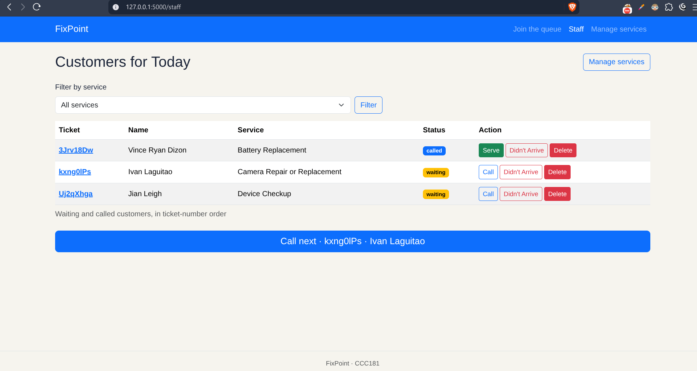

## Staff dashboard after creating 5 tickets and called one, served one, and let one person leave. Only 3 rows are left because when a person is marked as served or left the queue, it is removed from the list, but data is still in the database.

## tickets Table
### As you notice, there is no service_id, this is because I made a separate table to list the services chosen of a ticket, this is to allow one ticket to avail multiple services.

## service_chosen Table
### As you notice there are 6 rows, but we only have 5 tickets. This is because one ticket has chosen two services.

# After docker and flask restart

