## 1 Title details:
   App name: Fix Point
   Setting: Cellphone repair shop
   Student: Vince Ryan P. Dizon
   Student ID: 2024-2127
   Section: CS3A
   Date: Nov 11, 2026
   PR LINK: 

## Requirements

I wrote **17 functional requirements** and **7 non-functional requirements**. The MVP includes FR-01, FR-02, FR-03, FR-04, FR-05, FR-07, FR-08, FR-09, and FR-13.

A customer who needs a device repair said that sending a picture of the device’s condition and concern would help the technician assess it before the customer arrives. They said requirements 8, 9, and 10 mattered most to them and that they saw nothing else wrong. In response, I added **FR-17** for customers to send a picture of their device’s state and concern.

See the [full requirements document](../week3/requirements.md).

## Schema

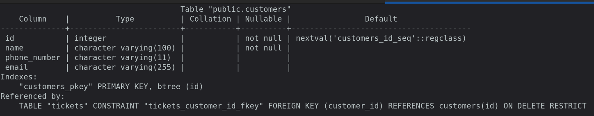
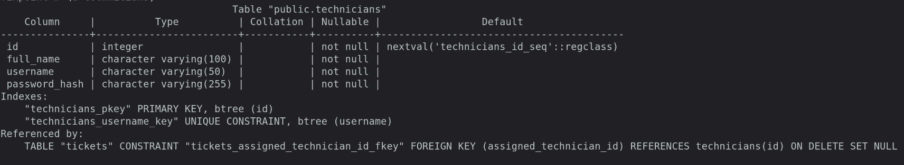
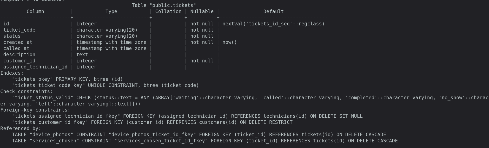
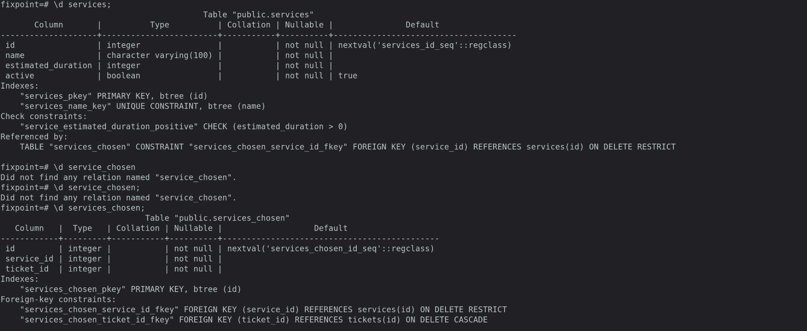
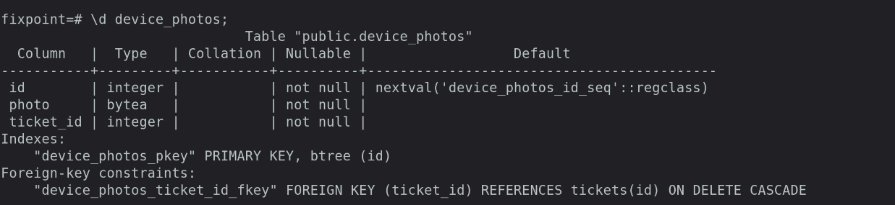

## Design decisions

1. **Allow email instead of requiring a phone number.** Rey's phone is broken, and he uses a laptop with Wi-Fi or a hotspot. Letting him provide email as his contact method means he can still join the queue (FR-01) without a working phone.
2. **Use a `services_chosen` table to connect tickets and services.** A repair visit may need more than one service. Keeping these associations in a separate table lets a ticket include multiple services, supporting the service selection and display in FR-01 and FR-02.
3. **Store device photos separately from tickets and link them to the ticket.** FR-17 lets customers send a picture of their device's state and concern for Winston to assess. A separate `device_photos` table stores the image and associates it with the relevant ticket.

## Self-review

I found two main problems in my schema: I had missed the `description` column needed to capture the customer's concern in FR-17, and a `service_id` directly on `tickets` would limit each ticket to one service. I added `description` to `tickets` and created a `services_chosen` table with `ticket_id` and `service_id`, allowing one ticket to include multiple services. I also updated the schema's table list, constraints, delete rules, relationship sentences, and ERD.

## Migrations

- [`697400571e57_initial_tables.py`](../../migrations/versions/697400571e57_initial_tables.py): Creates the initial customers, services, technicians, tickets, device photos, and chosen-services tables with their constraints and relationships.
- [`20261110_add_customer_email.py`](../../migrations/versions/20261110_add_customer_email.py): Adds an optional email column to customers.
- [`20261110_allow_email_only_customers.py`](../../migrations/versions/20261110_allow_email_only_customers.py): Makes the customer phone number nullable so customers can register with email only.
- [`ca832af49b2d_add_services_active.py`](../../migrations/versions/ca832af49b2d_add_services_active.py): Adds a non-null `active` flag with a default of `true` to services.
- [`20261111_customer_phone_number_length.py`](../../migrations/versions/20261111_customer_phone_number_length.py): Changes the customer phone number column from 15 to 11 characters while keeping it optional.
- [`20261111_merge_heads.py`](../../migrations/versions/20261111_merge_heads.py): Merges the phone-number-length and service-active migration branches without making further schema changes.

## CRUD

Routes below are grouped by the database operation they perform. Service-management routes do not have a dedicated functional requirement ID in my requirements list.

### Create
- `POST /join` — creates or updates the customer contact record and creates a ticket, selected-service associations, and uploaded photos. **FR-01, FR-08, FR-17**
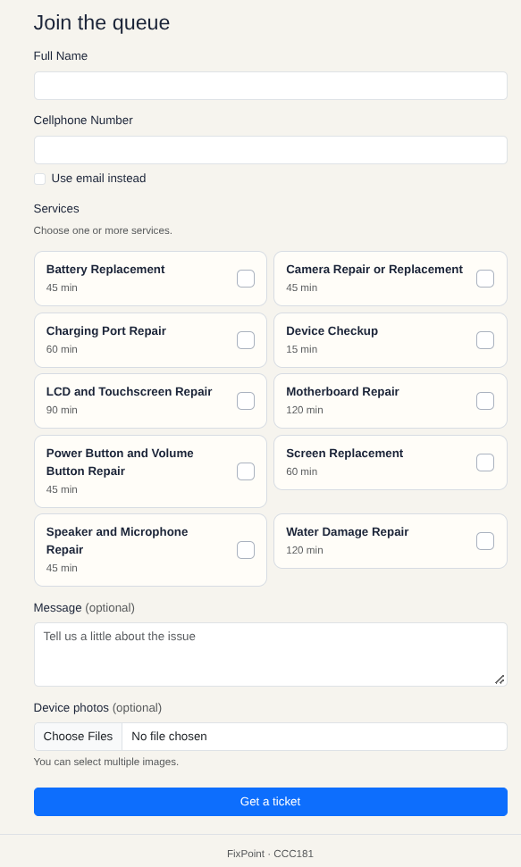

- `POST /staff/services` — creates a repair service. **No dedicated FR**

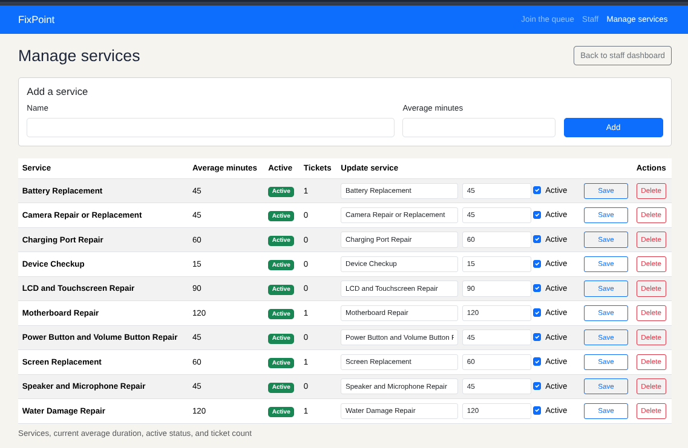

### Read

- `GET /join` — displays the join form and available active services. **FR-01**

- `GET /queue/<ticket_id>` — displays the customer's ticket, services, status, queue position, and estimated wait. **FR-02, FR-09**
- `GET /queue/<ticket_id>/status.json` — returns the ticket status, people ahead, and estimated wait. **FR-02**

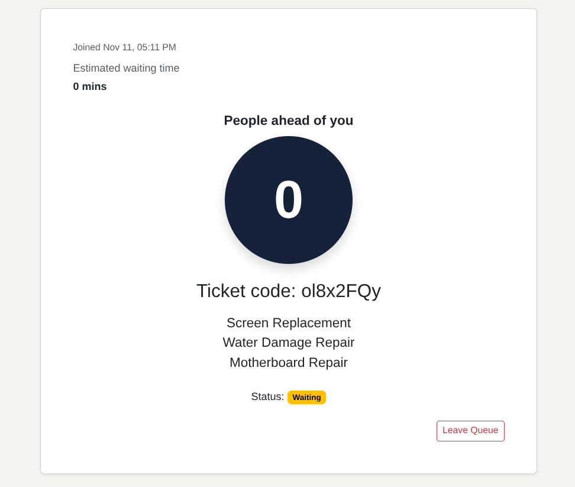

- `GET /staff` — displays and filters the staff queue. **FR-06, FR-07**
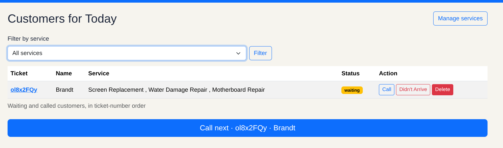

- `GET /staff/services` — displays the service list. **No dedicated FR**

### Update

- `POST /staff/tickets/<ticket_id>/<action>` — changes a ticket to called, completed, or no-show. **FR-04, FR-05**

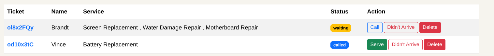

- `POST /staff/call-next` — marks the next waiting ticket as called. **FR-04**
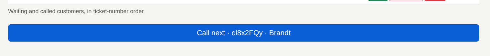

- `POST /staff/services/<service_id>/edit` — updates a service's name and estimated duration. **No dedicated FR**

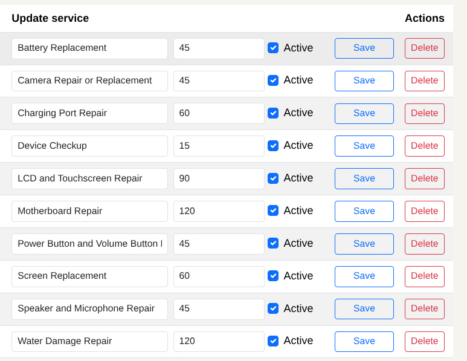

### Soft delete

- `POST /queue/<ticket_id>/leave` — keeps the ticket record but changes its status to `left`. **FR-03**
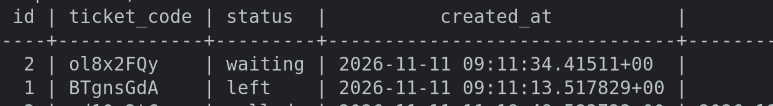

- `POST /staff/services/<service_id>/edit` — when submitted with the service disabled, sets `active` to false instead of deleting the service. **No dedicated FR**
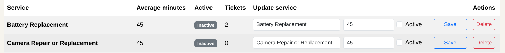

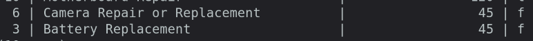

### Hard delete

- `POST /staff/tickets/<ticket_id>/delete` — permanently deletes a ticket; associated photos and chosen-service rows are also deleted through their foreign-key cascades. **No dedicated FR**

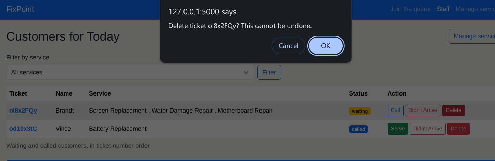

- `POST /staff/services/<service_id>/delete` — permanently deletes a service if no tickets reference it; otherwise deletion is blocked. **No dedicated FR**

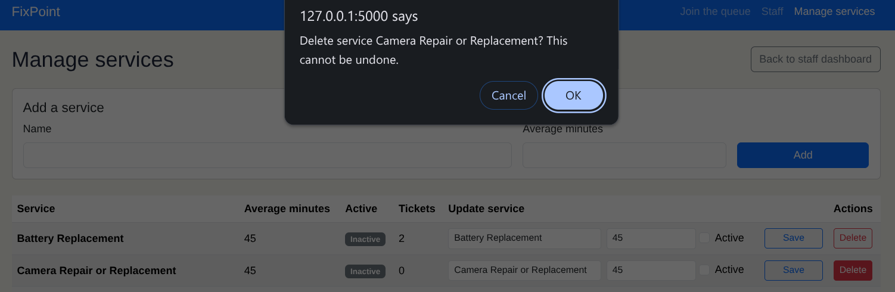

## Validation

Validation covered browser-side form requirements, Flask rejection of invalid submissions, PostgreSQL constraints, and a source check for SQL built with f-strings. The browser requires a name, contact method, and service; Flask returned `400 BAD REQUEST` without saving tickets for empty or overlong names, invalid email, and inactive services. PostgreSQL probes confirmed the foreign-key, check, unique, not-null, and delete-restrict constraints; a valid ticket insert also confirmed that the database generates its ID and creation time. The SQL f-string check found no matches.

The most useful PostgreSQL error was the `ON DELETE RESTRICT` response when trying to remove a service already used by a ticket: `ERROR: update or delete on table "services" violates foreign key constraint "services_chosen_service_id_fkey" on table "services_chosen"`. It clearly identifies the constraint and related table, showing why referenced services cannot be deleted.

See the [full validation tests and results](validation.md).

## Persistence

### Before Restart

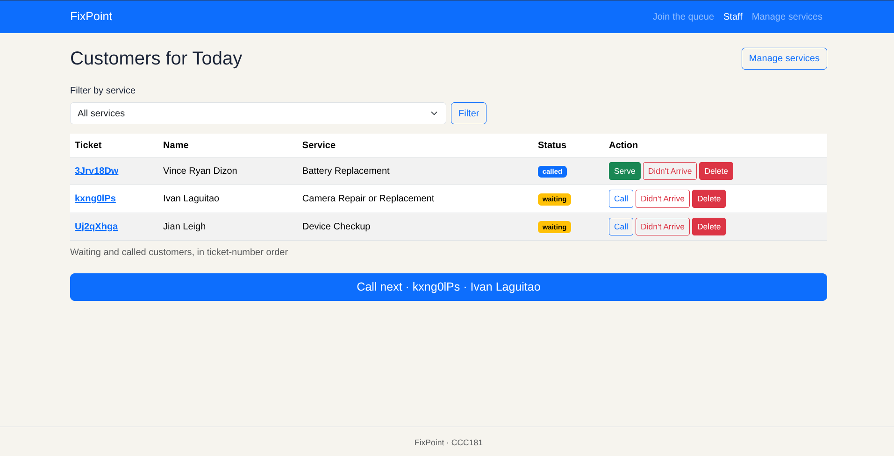
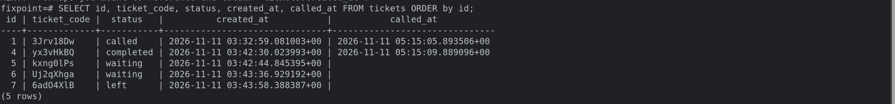
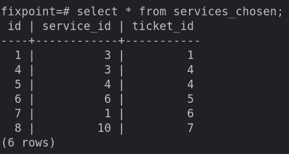

### After Restart

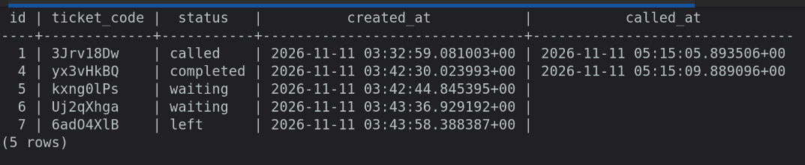
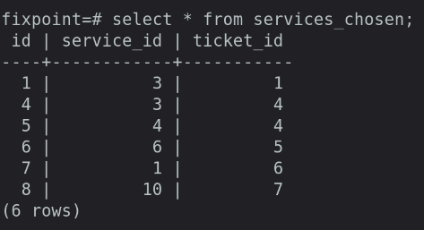
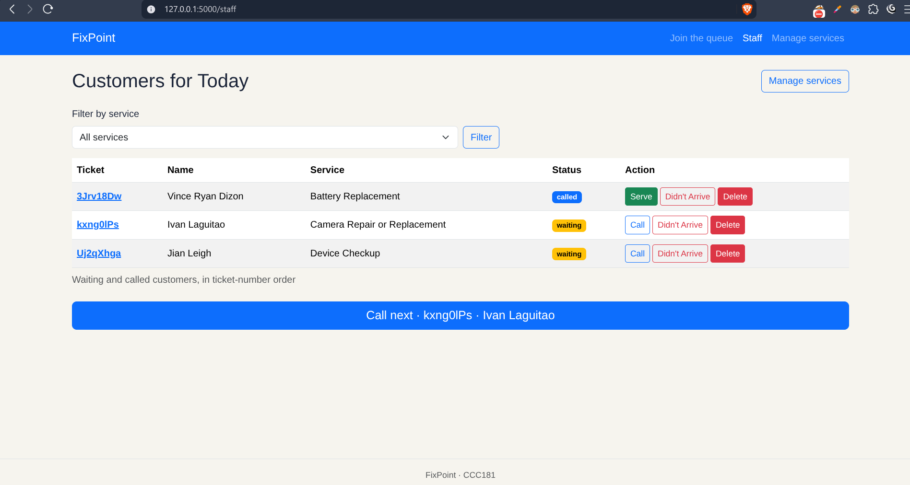

### Reflection

The hardest part this week was keeping the database schema, SQLAlchemy models, and Alembic migrations consistent as the design changed—for example, allowing email-only customers and supporting multiple services on one ticket. The requirement I found hardest to make testable was **NFR-03**, which says the Join, My Place, and staff queue pages must load within two seconds with 10 concurrent users on a mobile connection. It has measurable limits, but testing it reliably requires a repeatable way to simulate both the users and the mobile network. A report Winston would find useful is the daily number of tickets for each service grouped by outcome—completed, no-show, or left—so he can see which services have the most customers who leave before being served. I will write the query for this report in Week 5.

## Declaration

Used AI as an assistant in implementing features.