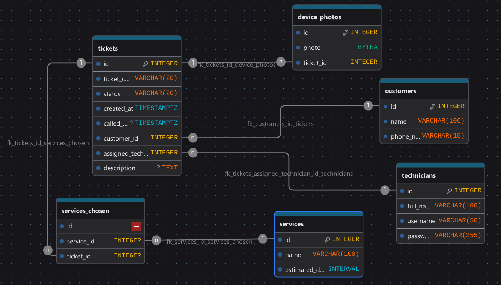

## 2a. Find the nouns in your requirements

| Req ID | Requirement | Nouns | Table or column? |
| :--- | :--- | :--- | :--- |
| FR-01 | A **customer** can join the **queue** by entering their **name**, **phone number** and choosing a **service type**. | customer, queue, name, phone number, service type | `customers`; `customers.name`; `customers.phone_number`; `services`; `tickets.customer_id`; `tickets.service_id`; queue is not a table |
| FR-02 | A **customer** can see their **ticket number**, **status**, **service** chosen, how many **people** are ahead of them and estimated **waiting time**. | customer, ticket number, status, service, people, waiting time | `tickets.ticket_number`; `tickets.status`; `tickets.service_id`; people ahead and estimated waiting time are computed, not stored |
| FR-03 | **Customers** can choose to leave the **queue**. | customers, queue | `tickets.status` (for example, `left`) and `tickets.left_at`; queue is not a table |
| FR-04 | The **technician** can call the next waiting **ticket** for a **service**. | technician, ticket, service | `staff_accounts`; `tickets.status` and `tickets.called_at`; `tickets.service_id`; next ticket is selected from waiting tickets ordered by `created_at` |
| FR-05 | The **technician** can mark a **ticket** as no-show (**Customer** did not arrive) or Served/Completed. | technician, ticket, customer, no-show, Served/Completed | `staff_accounts`; `tickets.status` (for example, `no_show` or `completed`) and corresponding status-change timestamps; customer is associated through `tickets.customer_id` |
| FR-07 | The **technician** can see all the **customer's Ticket ID**, **Name**, **Service**, and **Status**. | technician, customer, Ticket ID, Name, Service, Status | `staff_accounts`; `tickets.id`; `customers.name`; `tickets.service_id` (service name from `services`); `tickets.status` |
| FR-08 | **Technician** can manually add a walk-in **customer** to the **queue**. | technician, customer, queue | `staff_accounts`; `customers`; `tickets`  |
| FR-13 | **Technician** can login using an **account**. | technician, account | `staff_accounts` (for example, `username` and `password_hash`) |
| FR-14 | Assigning a **customer** to a **technician** (maybe Winston hires an assistant) & **Customers** can choose a preffered **technician** | customer, technician | `tickets.assigned_technician_id`; `customers.preferred_technician_id`; technicians represented by `staff_accounts` |
| FR-16 | **System** auto notifies the **customer** when called via **SMS** | system, customer, SMS | `sms_notifications` (for example, `ticket_id`, `sent_at`, and delivery status); recipient can be associated with `customers.phone_number` |
| FR-17 | **Customer** can send **picture** about their **device's state** and **concern** | customer, picture, device, state, concern | `ticket_photos` (for example, `ticket_id`, `image_path`, `device_state`, `concern`, and `uploaded_at`); ticket links to its customer |

## Modeling notes

- The **queue is not a table**. It is the set of tickets with `status = waiting` for a service, ordered by `created_at`.
- Store facts, not results: record when a ticket was created or its status changed, and compute the number of people ahead and estimated waiting time when requested.
- `customers`, `services`, `tickets`, and `staff_accounts` are proposed entities. The `sms_notifications` and `ticket_photos` tables support the corresponding requirements if those features are implemented.

## 2b. List your tables and columns

### FixPoint Database Schema

| Table | FixPoint columns |
| ----- | ----- |
| `tickets` | id, ticket_code, status, created_at, called_at, service_id, customer_id, assigned_technician_id |
| `device_photos` | id, photo, ticket_id |
| `services` | id, name, estimated_duration |
| `customers` | id, name, phone_number |
| `technicians` | id, full_name, username, password_hash |
| `services_chosen` | id, service_id, ticket_id |

## 2c. Choose types and constraints on purpose

| Table | Column | PostgreSQL type | Constraint | Why |
| ----- | ------ | --------------- | ---------- | --- |
| `tickets` | `id` | `integer GENERATED ALWAYS AS IDENTITY` | `PRIMARY KEY` | Database-generated internal identifier for each ticket |
| `tickets` | `ticket_code` | `VARCHAR(20)` | `NOT NULL UNIQUE` | Generated by a helper function, it may contain strings and numbers |
| `tickets` | `status` | `varchar(20)` | `NOT NULL, CHECK (status IN ('waiting', 'called', 'completed', 'no_show', 'left'))` | Restricts tickets to the supported queue states |
| `tickets` | `created_at` | `timestamptz` | `NOT NULL DEFAULT now()` | Records when the ticket entered the queue with its time zone |
| `tickets` | `called_at` | `timestamptz` | `NULLABLE` | Records when a technician called the ticket; null until called |
| `tickets` | `description` | `text` | `NULLABLE` | Lets customers optionally describe their issue |
| `tickets` | `customer_id` | `integer` | `NOT NULL, FOREIGN KEY REFERENCES customers(id)` | Every ticket must belong to an existing customer |
| `tickets` | `assigned_technician_id` | `integer` | `FOREIGN KEY REFERENCES technicians(id)` | Allows an optional technician assignment and prevents references to missing technicians |
| `device_photos` | `id` | `integer GENERATED ALWAYS AS IDENTITY` | `PRIMARY KEY` | Database-generated identifier for each uploaded photo |
| `device_photos` | `photo` | `BYTEA` | `NOT NULL` | Stores the raw image bytes |
| `device_photos` | `ticket_id` | `integer` | `NOT NULL, FOREIGN KEY REFERENCES tickets(id)` | Every photo must be associated with an existing ticket |
| `services` | `id` | `integer GENERATED ALWAYS AS IDENTITY` | `PRIMARY KEY` | Database-generated identifier for each service |
| `services` | `name` | `varchar(100)` | `NOT NULL UNIQUE` | Requires a name and prevents duplicate service names |
| `services` | `estimated_duration` | `integer` | `NOT NULL, CHECK (estimated_duration > 0)` | Stores a positive estimated duration in minutes as a number |
| `customers` | `id` | `integer GENERATED ALWAYS AS IDENTITY` | `PRIMARY KEY` | Database-generated identifier for each customer |
| `customers` | `name` | `varchar(100)` | `NOT NULL` | A customer name is required to create a ticket |
| `customers` | `phone_number` | `varchar(15)` | `NOT NULL` | Required contact detail; text preserves leading zeros and symbols used in phone numbers |
| `technicians` | `id` | `integer GENERATED ALWAYS AS IDENTITY` | `PRIMARY KEY` | Database-generated identifier for each technician |
| `technicians` | `full_name` | `varchar(100)` | `NOT NULL` | A technician's name is required |
| `technicians` | `username` | `varchar(50)` | `NOT NULL UNIQUE` | Requires a login name that is unique to each technician |
| `technicians` | `password_hash` | `varchar(255)` | `NOT NULL` | Requires a stored password hash for authentication, not a plaintext password |
|`services_chosen`| `id` | `integer GENERATED ALWAYS AS IDENTITY` | `PRIMARY KEY` | Database-generated identifier for each record |
|`services_chosen`| `service_id` | `integer` | `NOT NULL, FOREIGN KEY REFERENCES(service.id)` | Ensures each chosen service refers to an existing service |
|`services_chosen`| `ticket_id` | `integer` | `NOT NULL, FOREIGN KEY REFERENCES(ticket.id)` | Ensures each record is associated with an existing ticket |

`estimated_duration` is measured in minutes. Phone numbers are stored as text because they are identifiers, not quantities; dates, times, and numeric measurements use temporal or numeric PostgreSQL types.

## 2d. Draw the ERD

.

### Relationship sentences

One customer can have many tickets, and each ticket belongs to exactly one customer. 

One service can have many tickets, and each ticket uses exactly one service. 

One ticket can have many `services_chosen` records, and each record belongs to exactly one ticket. One service can appear in many `services_chosen` records, and each record refers to exactly one service.

One technician can be assigned to many tickets, while each ticket has exactly one assigned technician. 

One ticket can have many device photos, and each device photo belongs to exactly one ticket.

### Delete Rules

| Foreign key | On parent delete | Why |
| --- | --- | --- |
| `tickets.service_id` → `services.id` | `RESTRICT` | A service with existing tickets cannot be deleted, preserving the service history recorded by those tickets. |
| `tickets.customer_id` → `customers.id` | `RESTRICT` | A customer with existing tickets cannot be deleted, preserving ticket ownership and history. |
| `tickets.assigned_technician_id` → `technicians.id` | `SET NULL` | Deleting a technician removes only the optional assignment; the ticket and its history remain. |
| `device_photos.ticket_id` → `tickets.id` | `CASCADE` | Photos belong only to their ticket, so deleting the ticket also removes its associated photos. |
| `services_chosen.service_id` → `services.id` | `RESTRICT` | A service with existing chosen-service records cannot be deleted, preserving those associations. |
| `services_chosen.ticket_id` → `tickets.id` | `CASCADE` | Chosen-service records belong to their ticket, so deleting the ticket also removes those records. |

## 2e. Check that it is normalized

1. NO
2. NO
3. NO